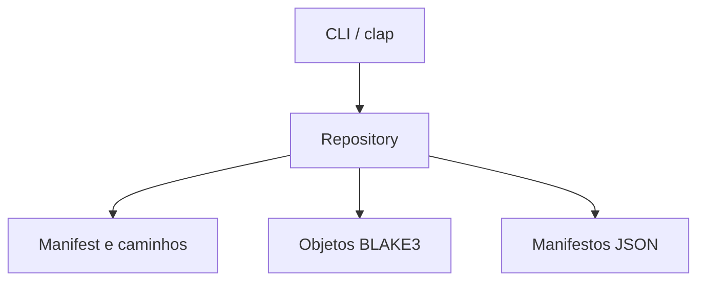

# Arquitetura implementada

A CLI recebe um comando tipado por clap e chama a API de `Repository`. O domínio valida os manifestos independentemente da interface; o adaptador de arquivos mantém objetos e manifestos em pastas próprias.

## Fluxo de salvamento

1. Validar nome, repositório e separação entre origem e destino.
2. Obter a trava de escrita com criação exclusiva de `.write-lock`.
3. Varrer e calcular os hashes; produzir o mesmo plano usado por `plan`.
4. Verificar objetos existentes e copiar somente conteúdos novos para temporários.
5. Conferir hash e tamanho do temporário antes de publicar o objeto sem sobrescrita.
6. Gravar o manifesto somente depois dos objetos. Soltar a trava ao finalizar.

Os objetos são imutáveis para a aplicação. Uma falha antes do manifesto pode deixar objetos não referenciados, mas não substitui snapshots anteriores. A ferramenta não fornece uma transação entre vários arquivos nem uma garantia de recuperação após qualquer falha física de armazenamento.

## Fluxo de restauração

O mesmo manifesto validado é usado para conferir objetos e restaurar. Todos os objetos são verificados antes da criação do destino. O destino deve estar ausente. Os arquivos são criados com exclusividade e verificados novamente após a cópia; uma falha posterior deixa a pasta parcial.

Detalhes: `docs/FORMATO.md`, `docs/OPERACAO.md` e `docs/DECISOES.md`.
